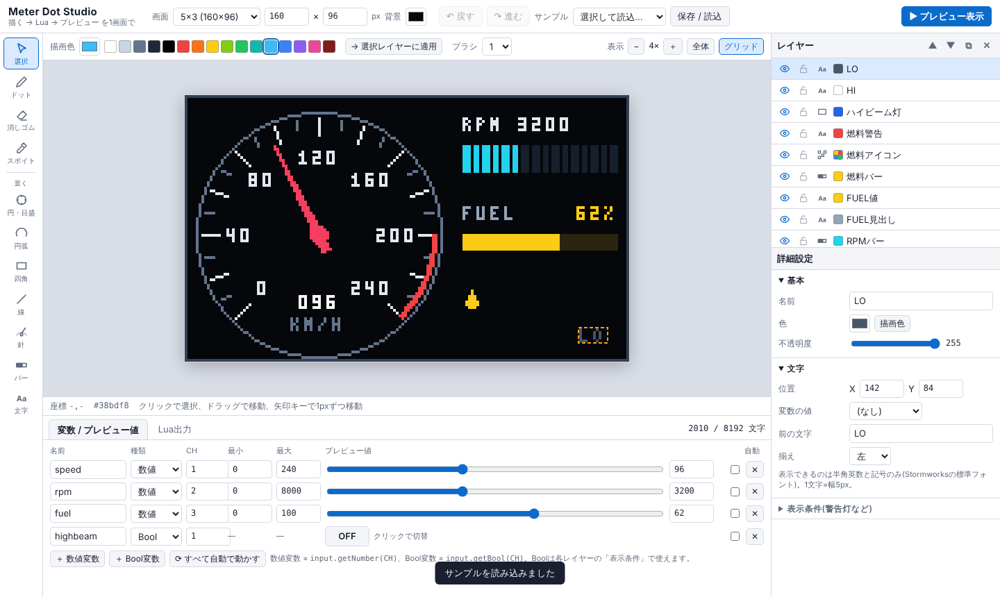

# Stormworks Meter Dot Studio

**日本語: [README.md](README.md)**

A browser tool for making Stormworks gauges and digital panels: **paint it, move the values live, and export it as Lua, all on one screen.**

> **▶ Try it: https://KomachiRaisu.github.io/Stormworks-Meter-Dot-Studio/**
> (No install. Just open it in a browser.)

## Why

The usual workflow was four separate steps: draw a base in GIMP, convert it to Lua, generate the needle with AI, then test in PonyIDE. This tool does all of it in one place.

## Features

- **Pixel editor**: pencil, eraser, eyedropper, brush size, image-to-dots import
- **Circles with ticks**: aliasing-free circles with computed major/minor ticks and numeric labels
- **Arcs**: red zones, or value-driven progress arcs
- **Needles**: rotate by value, with configurable angle range (line or tapered triangle)
- **Bars**: solid, segmented (digital-panel style), or moving marker, with a warning color zone
- **Text**: show a variable with round / floor / ceil, decimal places and zero padding
- **Per-element color and opacity**
- **Layers**: show/hide, lock, drag to reorder, duplicate
- **Number and Bool variables**: drive them with sliders / ON-OFF toggles (ranges are editable). Bool variables control layer visibility (warning lamps etc.)
- **Optimized Lua export**: removes redundant `setColor` calls, aliases API functions, drops unused variables, shortens numbers, and packs large pixel art into strings. Shows usage against the 8192 / 4096 character limit
- **Samples**: car, train, simple PFD

## Usage

1. Pick a tool on the left and click / drag on the screen to place a part.
2. Adjust it in the Layers and Details panels on the right. Move the sliders in the bottom panel to test.
3. Open the **Lua** tab, press **Copy**, and paste it into a Stormworks microcontroller script.

Number variables are read with `input.getNumber(CH)`, Bool variables with `input.getBool(CH)`.

## Known limitations

- Preview fonts and circle shapes can differ from the game by a few pixels.
- Text supports only ASCII (the in-game font).
- Not extensively tested in the game yet. Please open an issue if you find a problem.
- No rotating backgrounds (e.g. a PFD horizon) or scrolling tapes yet.

## Run locally

It is a single `index.html` with no build step. Open it in a browser. Work is autosaved in localStorage and can also be exported as JSON.

## Disclaimer

Stormworks: Build and Rescue is a trademark of Sunfox Games. This is an **unofficial fan-made tool** and is not affiliated with Sunfox Games.

## License

[MIT](LICENSE)
